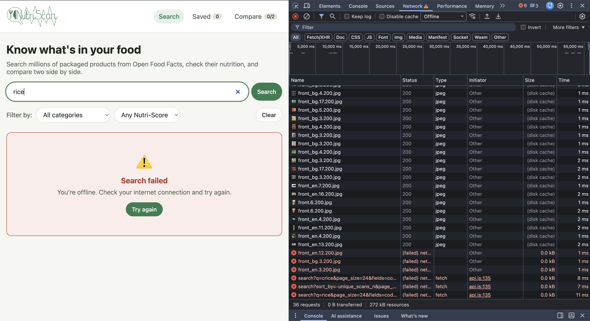
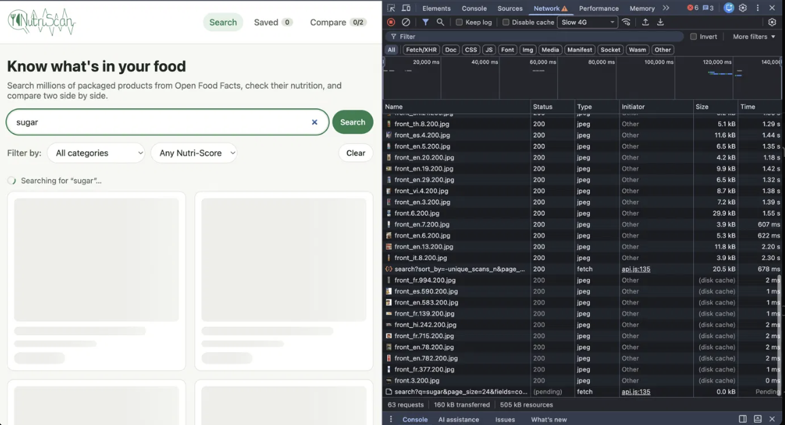
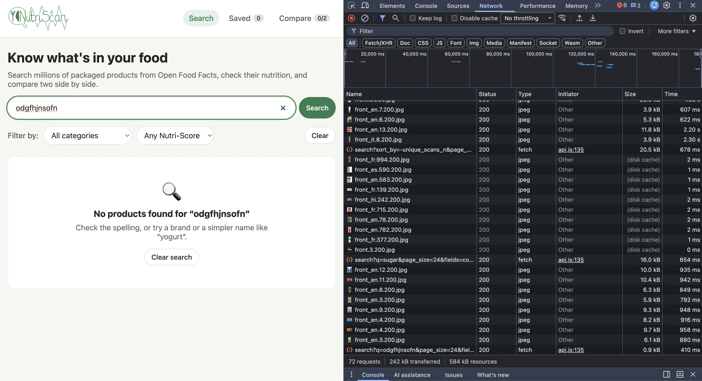

# NutriScan

**Know what's in your food.** NutriScan is a React web app for searching millions of packaged food products from the [Open Food Facts](https://world.openfoodfacts.org) database, reading their nutrition clearly, and comparing two products side by side.

ISTE 340 Client Programming · Fall 2026 · Theme A (food and nutrition explorer) · Team **Macro Managers**

> **Repository:** _add your GitHub link here_ · **Demo video:** _add the video link here_

## What it does

- **Search** live product data as you type (debounced), with **Category** and **Nutri-Score** filters and **Load more results** to go beyond the first 24 matches.
- **Product page** with the Nutri-Score, a per-100 g nutrition table, ingredients and allergens.
- **Save** products to a list and **pin two to compare** side by side. The healthier value in each row is highlighted and a verdict picks the better choice.
- **My limits**: set your own sugar and salt limits per 100 g. Any product above them is marked in red on its product page and on Compare.
- Saved products, pins and limits are **remembered on your device** (localStorage).
- Clear **loading, error and empty states**, and it works on phones (tested down to 320 px wide).

## Prerequisites

- **[Node.js](https://nodejs.org) 18 or newer** (includes npm). Check with `node -v`.
- A modern browser (Chrome, Edge, Firefox or Safari).
- An internet connection, because the app loads live data from Open Food Facts.

**No API key, account or environment variables are needed.** Open Food Facts is a free, open database. The app identifies itself with a `User-Agent` header set in `vite.config.js`, as Open Food Facts asks. There is no `.env` file and no secret in this repository.

## Run it

```bash
git clone <repository-url>
cd nutriscan
npm install
npm run dev
```

Then open the address it prints, usually **http://localhost:5173**.

`npm install` is required the first time on every computer. `node_modules` is not included, because it is built for each operating system. If you see `'vite' is not recognized` or `vite: command not found`, run `npm install` first.

### Production build

```bash
npm run build     # creates an optimised build in dist/
npm run preview   # serves dist/ at http://localhost:4173
```

**Why `npm run preview` and not any static file server:** the browser never calls Open Food Facts directly. It calls our own server at `/off-search` and `/off-api`, and Vite forwards those requests (see *Which API we call, and why* below). Vite's dev server and `vite preview` both include that proxy and send every page URL (like `/saved`) to `index.html`. A plain static server has neither, so searches would return 404 and refreshing `/saved` would show the server's own 404 page. Hosting it publicly would need the same two rules on the host: proxy `/off-search` → `https://search.openfoodfacts.org` and `/off-api` → `https://world.openfoodfacts.org`, and fall back to `index.html` for every other path.

| Command | What it does |
|---|---|
| `npm install` | Installs React, React Router and Vite |
| `npm run dev` | Development server with live reload and the API proxy |
| `npm run build` | Production build into `dist/` |
| `npm run preview` | Serves the production build, with the API proxy |

## Project structure

```
src/
  main.jsx               App entry: Router + ProductsProvider (Context)
  App.jsx                Layout and routes
  pages/                 SearchPage, ProductDetailPage, SavedPage, ComparePage, LimitsPage, NotFoundPage
  components/            Navbar, SearchBar, FilterBar, ProductCard, NutritionTable, CompareColumn, StatusMessage…
  context/               ProductsContext.jsx: saved, pinned and limits, persisted to localStorage
  hooks/                 useProductSearch (search + paging + cache), useProduct, usePageTitle
  services/api.js        Every request to Open Food Facts, error handling, rate limiting, data cleaning
  utils/nutrition.js     Nutrient rows, formatting, and the Compare verdict
docs/                    Test screenshots and the AI reflection
```

**Built with:** React 18, React Router 6, Vite 5 and CSS Modules. There's no UI library; all styles are ours.

## How it works

### Routes

| Path | Page |
|---|---|
| `/` (and `/?q=…`) | Search. The query is in the URL, so results can be bookmarked and Back works. |
| `/product/:code` | One product, by barcode |
| `/saved` | Saved products |
| `/compare` | Two pinned products side by side |
| `/limits` | My limits form |
| anything else | Page not found |

Every page sets its own browser tab title (for example "Compare · NutriScan").

### Shared state and persistence

`ProductsProvider` (`src/context/ProductsContext.jsx`) holds the saved products, the two pinned products and the user's limits, and wraps the app in `main.jsx`. Pages and the Navbar read it with the custom hook `useProducts()`, so `App.jsx` passes no props. Each value is read from localStorage once, with a lazy `useState` initialiser, and written back by its own `useEffect`. Every read is in `try/catch` and validated, so missing or corrupt data falls back to an empty list or default limits instead of crashing.

### The My limits form

Two controlled inputs (sugar and salt, grams per 100 g), submitted in React with no reload. The rules are: required, a plain number (no letters, minus signs or commas), at most 100 and at most one decimal place. Each error appears under its field, names the field and says what to type, and disappears as soon as the value is valid. An invalid form is never saved, and focus moves to the first field to fix. The search box has its own rules too: empty, spaces only, under 2 letters, over 60 characters and symbols only are all blocked before any request is sent.

### The Compare verdict

Products are first compared on Nutri-Score (A is best). If both have the same grade, the lower sugar wins. If either product has **no** Nutri-Score, its grade is treated as unknown, not as worse than E, and the verdict falls back to sugar and says why.

### Fetching: async/await, try/catch/finally, `res.ok`

`fetchJson()` in `src/services/api.js` wraps every request:

- **`async`/`await`** inside **`try` / `catch` / `finally`**.
- **`res.ok` is checked**, so a non-2xx response (404, 429 rate limit, 5xx) throws an error instead of being treated as data.
- A **15-second timeout** turns a hanging request into a readable error; `finally` always clears the timer.
- Every failure becomes an `ApiError` with a message that is safe to show on screen: offline, network, timeout, rate limit, not found, server error, or unreadable response.

### Which API we call, and why (a problem we hit while testing)

We first searched with the main API's `cgi/search.pl`. During testing it started failing: Open Food Facts allows only **10 searches per minute** on it, warns *"don't use it for a search-as-you-type feature, you would be blocked very quickly"* ([API docs](https://openfoodfacts.github.io/openfoodfacts-server/api)), and at busy times it shows *"Page temporarily unavailable … not available to anonymous users"* (HTTP 503). Those blocked replies carry no CORS header, so the browser only reported a "CORS error".

What we changed:

- **Search now uses [Search-a-licious](https://openfoodfacts.github.io/search-a-licious/users/ref-openapi)** (`search.openfoodfacts.org`), Open Food Facts' dedicated full-text search service. It returns products in `hits`, and sends `brands` as a list, which `normalizeProduct()` handles. Product pages still use the main API's `api/v2/product/{barcode}.json`.
- **A Vite proxy** (`vite.config.js`): Search-a-licious sends no CORS headers, so the browser calls our own dev server (`/off-search`, `/off-api`) and Vite forwards the request. Real HTTP status codes (429, 503…) now reach our code, so the error messages are accurate. The proxy also sends a `User-Agent` naming the app, as Open Food Facts asks.
- **A request counter** (`reserveRequest()` in `api.js`) caps us at 15 searches and 14 product lookups a minute and shows "please wait N seconds" instead of getting blocked.
- **Caching:** search results are kept for 10 minutes (sessionStorage), so refreshing, going back or repeating a search costs no request. Opening a product from the results reuses the data we already have.
- **Query cleaning:** Search-a-licious reads Lucene syntax, so characters like `- : ( ) "` are turned into spaces first (`coca-cola` → `coca cola`) and can't cause a 400 error.

### The four states

The search hook keeps **one** `status` value (`'loading' | 'success' | 'error'`), so two states can never be on screen at once.

| State | When it shows | What the user sees |
|---|---|---|
| **Loading** | First load, and **every** later search | Skeleton cards with "Searching for …". Old results are removed first, so a spinner and stale data never show together. |
| **Error** | Request fails (offline, timeout, 404/429/5xx, bad JSON) | Red message explaining what happened, plus a **Try again** button. The search bar, filters and navigation keep working. |
| **Empty** | Only after a **finished search** returned 0 products | "No products found for “…”" with a suggestion. Never on first load, never during loading. |
| **Success** | Data arrived | Product cards from the API |

The product detail page has the same states, plus "Product not found" for unknown barcodes.

### Search on live data

- **Live search:** results update as you type, against the **live API**, after a 600 ms pause (debounce). Typing "chocolate" quickly sends one request, not nine. Enter searches immediately.
- **No stale results:** as soon as the text in the box differs from the results on screen, the results are replaced by loading skeletons, so results for a query you've moved past never stay on screen.
- Each request has an **`AbortController`**. Starting a new search cancels the previous one, so a slow older response can never replace newer results.
- The **Category** and **Nutri-Score** filters run on the **fetched API results**. Results arrive 24 at a time; **Load more results** fetches the next page (the API's `page` parameter), so filters can cover as many results as the user loads. The count shows how many matches exist in total.
- Results are cached per query for the session, so going back from a product page doesn't search again. This also keeps us under the API's search rate limit.

### Messy data

Open Food Facts data is crowd-sourced and often incomplete. `normalizeProduct()` cleans every product before the UI sees it:

- Numbers sent as text (`"30.9"`) are converted; missing or empty values become `null` and display as **"Not available"**.
- Nutri-Score values like `"unknown"` or `"not-applicable"` show as **Nutri-Score ?**.
- Allergen tags (`en:milk`) become readable text (`Milk`); an empty list shows "None declared".
- Missing names show "Unnamed product"; missing or broken photos show a placeholder.

### Accessibility

- Errors use `role="alert"` and are linked to their input with `aria-describedby`, and invalid inputs get `aria-invalid`.
- Nutri-Score badges and the active menu item meet WCAG AA contrast (4.5:1). B, D and "unknown" use dark text, and E uses a slightly darker red.
- Every page has exactly one `h1`, and heading levels never skip.
- The phone menu closes with **Escape**, and every button has an explicit `type`.

## Testing

### Screenshots
Screenshots are in the `docs` folder.

error-offline.png represents what the app would show in case the users loses access to internet and prompted the user wih a clear message instead of crashing and leaving the user confused

loading.png represents in the case the connection is slow what will the user see in this case the app shows the user "searching for sugar" with a loading circle next to it and the product cards greyed out to be loaded with the search results

empty.png represents what the user would see in case enter gibberish, the search request succeeded but returned zero products and the app saying "No products found" in a plain box which sets it apart from the loading screen and the red error box screen 

We tested every failure path ourselves in Chrome.

#### Error state (offline)



**How we tested it:** loaded the app while online, then opened DevTools (F12) → **Network** tab → throttling dropdown → **Offline**, then searched for "cheese". The app showed *"You're offline. Check your internet connection and try again."* with a Try again button. We switched back to **No throttling** and pressed **Try again**: results loaded, and no page reload was needed.

> Going offline and then *refreshing* shows Chrome's own "No internet" page, because the app itself can't download. That is expected. The error state is for requests that fail while the app is open.

#### Loading state



Tested with DevTools → Network → **Slow 4G** so the skeleton cards stay on screen long enough to see.

#### Empty state



Searched for `xqzvbnm`.

### Test checklist

| Test | Result |
|---|---|
| Clean install on a new machine: `npm install` then `npm run dev` | ✅ |
| `npm run build` then `npm run preview`: search, product pages and refreshing `/saved` all work | ✅ |
| First load shows skeletons, then popular products from the API | ✅ |
| Every new search shows skeletons, and old results disappear first | ✅ |
| Searching gibberish shows "No products found", only after loading ends | ✅ |
| Empty state never appears before the first search | ✅ |
| Offline search shows a readable error and Try again, and the app stays usable | ✅ |
| Try again after reconnecting loads results | ✅ |
| Typing "nutella" quickly sends one request (Network tab), after a short pause | ✅ |
| Searching "cola" then quickly "milk": only milk results appear, and the cola request is cancelled | ✅ |
| `coca-cola` (special characters) searches without errors | ✅ |
| **Load more results** adds the next 24, and a failed page keeps the existing results and shows an error under the button | ✅ |
| Filters apply to every loaded result ("filtered from 48 loaded") | ✅ |
| Compare page: ✕ Remove takes one product out, and Clear comparison removes both | ✅ |
| A product with no Nutri-Score is not ranked below an E product | ✅ |
| `/product/abc` (not a barcode) shows "Product not found" without sending a request | ✅ |
| Missing values show "Not available", not blanks or `undefined` | ✅ |
| My limits: empty, `abc`, `-3`, `1,5`, `150` and `1.25` each show their own message, and nothing invalid is saved | ✅ |
| Saved, pins and limits survive a reload and closing the tab | ✅ |
| Corrupt localStorage (`abc`) loads empty lists or default limits, with no crash | ✅ |
| No horizontal scrolling at 375 px and 320 px on every page, and the menu closes with Escape | ✅ |
| Chrome, Edge, Firefox, Safari (macOS), Safari (iPhone), Chrome (Android) | _fill in after testing_ |

## AI use

We used AI assistants during the project. What we asked, what we kept, what we rejected and why is in **[docs/AI_REFLECTION.md](docs/AI_REFLECTION.md)**.

## Team

| Member | Owns |
|---|---|
| Ebrahim Soni | Project setup, routing, `Navbar`, `NotFoundPage`, merging |
| Amaan Khan | `SearchPage`, `SearchBar`, `FilterBar`, `ProductCard`, responsive grid |
| Abdullah Naseem | `ProductDetailPage`, `NutritionTable`, `IngredientsBox`, `NutriScoreBadge` |
| Ifzaan Ahmad | `SavedPage`, `ComparePage`, `SavedRow`, `CompareColumn`, `ProductsContext`, `LimitsPage` |

## Credits

Product data © Open Food Facts contributors, under the [Open Database License](https://opendatacommons.org/licenses/odbl/1-0/).
